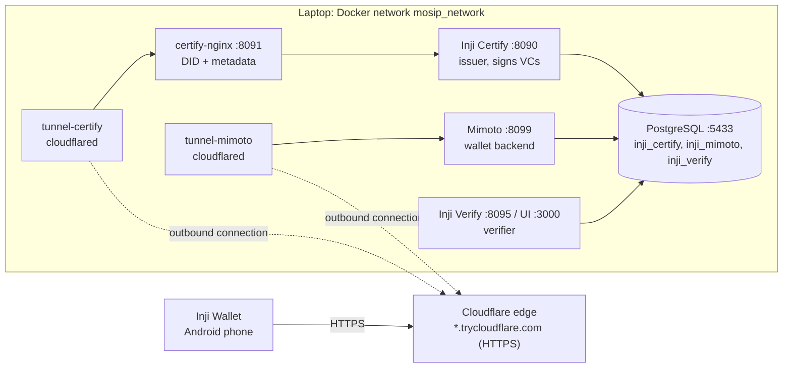

# Local Environment Architecture

The experimental environment runs on a Windows laptop (Docker Desktop with WSL2). Server components live in `env/stack`; the wallet working copy is set up by `env/wallet` at `C:\dev\inji-wallet` and runs on a physical Android phone.

## Diagram



Plain-text version:

```
 Android phone (Inji Wallet)
        |  HTTPS
        v
 Cloudflare edge  *.trycloudflare.com
        ^  outbound tunnel connections (no inbound ports opened)
        |
 +------------------------- Laptop, Docker ---------------------------+
 |  tunnel-certify --> certify-nginx :8091 --> Inji Certify :8090      |
 |  tunnel-mimoto  --> Mimoto :8099                                    |
 |                     Inji Verify :8095 (+ UI :3000)                  |
 |                     PostgreSQL :5433 (shared by all)                |
 +--------------------------------------------------------------------+
```

## Components

| Component | Image / port | Role | Thesis treatment |
|---|---|---|---|
| Inji Certify | `inji-certify-with-plugins:0.14.0`, 8090 | Issuer. Signs credentials; also its own OAuth server (pre-authorized code flow, no eSignet) | Unmodified counterparty |
| certify-nginx | `nginx:stable`, 8091 | Serves issuer DID (`/.well-known/did.json`), OpenID4VCI and OAuth metadata, static issuer config | Unmodified |
| Mimoto | `mimoto:0.21.0`, 8099 | Wallet backend: issuer list, proxies, some signing | Modified later (CSL) |
| Inji Wallet | React Native app on phone | Holder: key generation, issuance, presentation | Modified (main target) |
| Inji Verify | `inji-verify-service/ui:0.18.2`, 8095 / 3000 | Verifier for presentations | Unmodified counterparty |
| PostgreSQL | `postgres:15`, 5433 | One DB per service; holds Certify key aliases and credential config | Infrastructure |
| tunnel-certify, tunnel-mimoto | `cloudflare/cloudflared` | Public HTTPS URLs for Certify (via nginx) and Mimoto | Infrastructure |

## Why Cloudflare tunnels

| Requirement | Why `localhost` or a LAN IP fails |
|---|---|
| Android blocks cleartext HTTP | The wallet needs `https://` with a publicly trusted certificate |
| `did:web` resolves over HTTPS on a public domain | Issuer DID is `did:web:<host>`; any verifier fetches `https://<host>/.well-known/did.json` |
| `localhost` on the phone is the phone | The phone cannot see Docker ports on the laptop; LAN IPs change and have no valid certificate |

A tunnel container opens an outbound connection to Cloudflare. Cloudflare assigns a public HTTPS hostname with a valid certificate and relays requests back down that connection. No router or firewall ports are opened.

## Known limits of quick tunnels

| Behaviour | Consequence | Handling |
|---|---|---|
| Deleted by Cloudflare after sleep or network loss ("Tunnel not found") | Hostnames stop resolving; containers keep "Running" | `set-public-urls.ps1` detects and recreates them |
| New hostname on every recreate | Issuer DID changes; previously issued credentials stop verifying | Acceptable during setup. Before Phase 3/4 evidence: switch to a named Cloudflare tunnel on an owned domain (decision D-06) |

## Operational notes

Environment problems and fixes are listed in `known-issues.md`. Commands are run through `env/stack/stack.ps1`:

| Command | Purpose |
|---|---|
| `start` | Pull images, start containers, publish tunnels, run checks |
| `refresh-tunnels` | Replace dead tunnels; update issuer URL, DID and `wallet.env` |
| `check` | Container state, local and public endpoints, tunnel status, recent errors |
| `apply-patches` | Apply `sql/patches/*.sql` to the running database |
| `capture-baseline` | Save issuer DID and metadata under `evidence/` |
| `issue-offer` | Pre-authorized FarmerCredential offer as a QR code |
| `reset-keys` | Regenerate issuer keys (invalidates issued credentials) |
| `stop` | Stop containers, keep data |
